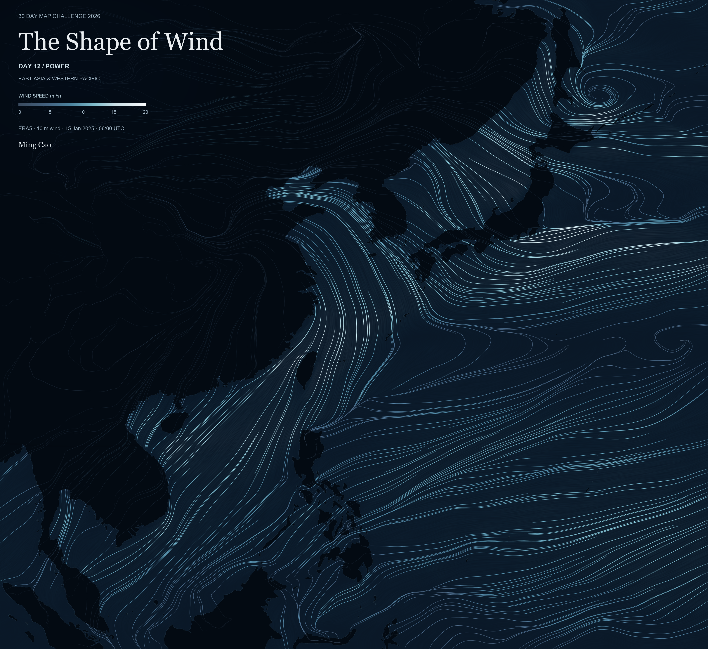
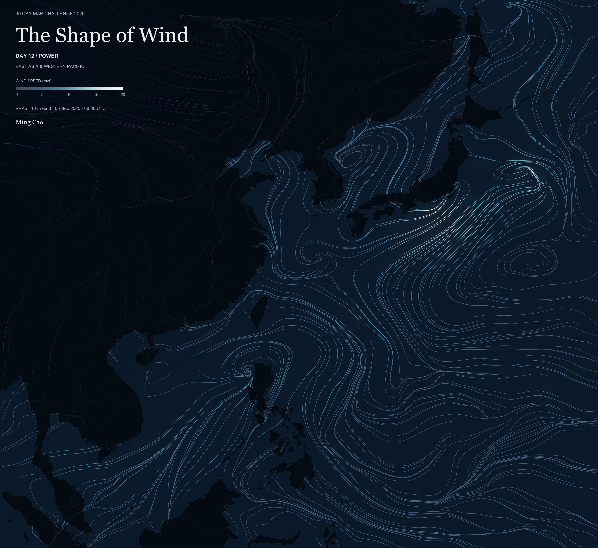

# The Shape of Wind — Two Snapshots of the Western Pacific

Two maps of ERA5 10 m wind over East Asia and the Western Pacific, captured at **06:00 UTC on 15 January and 5 September 2025**. Streamline direction follows the wind vectors; color and nominal brightness represent wind speed. The two snapshots reveal different spatial flow patterns across the same region.

Each GIF animates continuous, soft brightness textures along the corresponding map's fixed streamlines. This illustrates flow direction and patterns rather than observed atmospheric changes over time. **Each date uses its own single wind field; there is no temporal interpolation between January and September.**

## January 15, 2025



[Play the January Flowing Streamlines GIF](output/The_Shape_of_Wind_January.gif) (4.69 MB).

## September 5, 2025



[Play the September Flowing Streamlines GIF](output/The_Shape_of_Wind_September.gif) (4.11 MB).

Both PNGs are 3840 x 3520. Both GIFs are 1056 x 968, 66 distinct frames at 11.11 fps, lasting 5.94 seconds and looping infinitely. Titles, legends, geography and coastline remain stationary. The GIFs contain no moving particles, isolated highlights or weather-field morphing.

## Reproduce

Tested with Python 3.10 in the Windows `geospatial` environment. Identical typography requires the installed Georgia, Arial and Arial Bold fonts used by the drawing code.

From the repository root:

```powershell
python -m pip install -r 12/requirements.txt
python 12/scripts/fetch_era5.py
python 12/scripts/fetch_era5.py --config config/era5_request_september.json
python 12/scripts/render_static.py
python 12/scripts/render_gifs.py
python 12/scripts/verify_delivery.py
```

The downloader reuses NetCDF caches or resumes saved CDS jobs. Accept the dataset terms on CDS and configure credentials outside this repository in `.cdsapirc`; never put an API token into code or Git. Rendering is offline once data are cached. The two approved PNGs can be checked by rerendering without replacing them:

```powershell
python 12/scripts/render_static.py --verify
```

Optional actual browser playback verification requires a local Edge/Chrome installation:

```powershell
python 12/scripts/verify_delivery.py --browser
```

Use `--snapshot January` or `--snapshot September` on either rendering script to render one date. [METHODS.md](METHODS.md) documents the algorithms and parameters.

```text
12/
  README.md, METHODS.md, requirements.txt
  config/             requests, final style, exact curve selection, GIF settings
  data/cache/         local ERA5 NetCDFs and reproducible caches; ignored by Git
  data/source/        retained Natural Earth land geometry
  scripts/            download, shared drawing/data code, static/GIF rendering, validation
  metadata/           source provenance and final numerical/reproduction checks
  output/
    The_Shape_of_Wind_January.png
    The_Shape_of_Wind_January.gif
    The_Shape_of_Wind_September.png
    The_Shape_of_Wind_September.gif
```

Data: [Copernicus ERA5 hourly single levels](https://cds.climate.copernicus.eu/datasets/reanalysis-era5-single-levels), 0.25-degree grid. Geography: [Natural Earth](https://www.naturalearthdata.com/about/terms-of-use/), public domain. Map author: **Ming Cao**. Challenge: **30 Day Map Challenge 2026 / Day 12: Power**.
