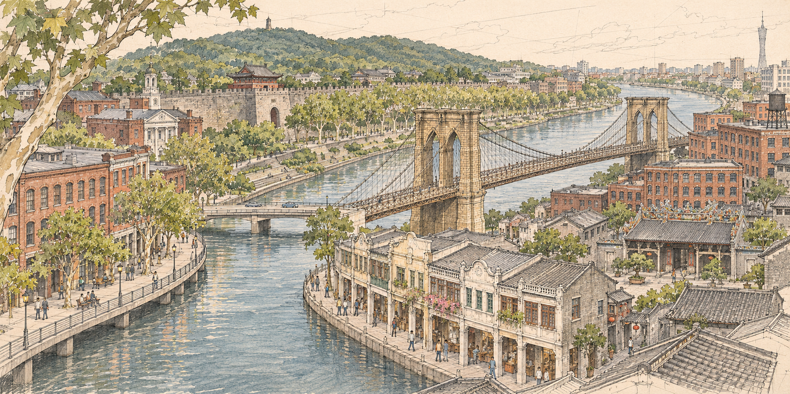
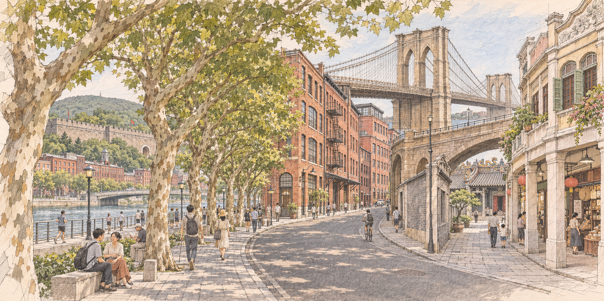
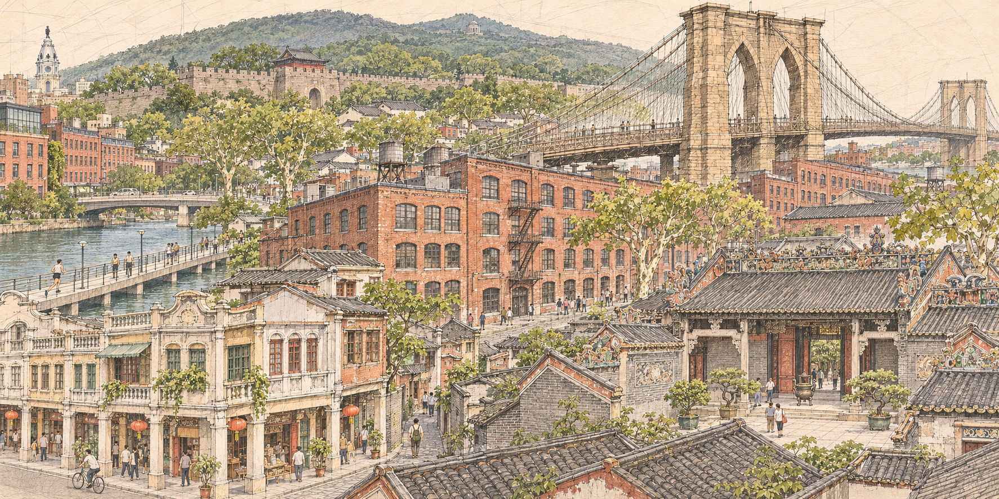

# Composition Studies — Illustrated Architectural Montage

三张均为 2:1 横向、1774 × 887 像素的构图预览。共享暖纸色、细线稿、低饱和水彩和左上方柔光，比较的是空间组织，不是配色。以下区分设计意图、当前图像实际表现和待修正项。

## A — River as the Spine

**位置与层次。** Philadelphia 意向的砖建筑和滨河步道位于左前景；南京城墙横贯左侧至中央的对岸台地，紫金山式低缓林山位于后方，梧桐列植沿岸延伸；Brooklyn Bridge 横跨中央至右中景，DUMBO 式砖仓库落在右岸；广州骑楼围合右前景河弯，宗祠式庭院在其后方露出。

**视角与动线。** 较高斜视，能同时看见屋顶、立面和岸线。视线从左下步道进入 S 形河道，经过中央桥塔与桥下水面，返回右下骑楼，再沿对岸林荫线进入远处。河弯是主骨架，两岸不是四块等分区域。

**过渡。** 低岸步道→台阶与树木→城墙山脚；砖仓库→层数降低的骑楼→庭院瓦顶。河岸曲线统一不同局部视角，建筑和树冠的遮挡解释局部方向变化。

**最成功。** 右岸砖仓库与骑楼的高度变化，以及两岸连续步行空间，较容易被读成同一城市。

**最不自然。** 左岸更像传统石砌河岸，缺少真实 Schuylkill Boardwalk 的近水混凝土板、独立支承与细栏杆；中央较低的道路桥与悬索桥交叠，连接关系不够清晰。城墙上出现未经核对的楼阁，远处还出现不必要的高塔；这些不能视为准确地标。

**下一步素材与工具。** 优先补齐 Locust–South Street 河段的步道侧视、板下支承、桥头坡道照片及断面；选定南京具体城墙段；用 SVG 或 3D 辅助确定两桥落点和岸线高程，再分层画河岸、建筑和树冠。水面应保留通行断面。无需继续增加地标。

## B — Street as the Spine

**位置与层次。** 南京梧桐树以近景树干和左至中央的林荫步道出现，城墙及林山退在左后方；Philadelphia 河岸从左中景的树间开口露出；DUMBO 式砖仓库构成中央街道立面；Brooklyn Bridge 位于右上方，桥下斜向支巷通往右前景广州骑楼和退后的宗祠式入口。

**视角与动线。** 接近人眼的局部透视，远低于 A/C。主街从下方进入中央，向右转弯；第二条路径从右侧柱廊穿过桥下，进入庭院。树干和仓库连续遮挡，使局部消失点变化有可见空间原因。

**过渡。** 梧桐树列的重复节奏接续砖墙窗列，再接续骑楼柱列；街道弯曲让滨河开口与桥下巷道交替显露。材料从红砖转为灰砖、浅色抹灰与灰瓦。

**最成功。** 行人尺度、树荫、商铺和支巷组成可信的步行叙事。右侧柱廊至院落的进入感最清楚。

**最不自然。** Brooklyn Bridge 的悬索主跨、塔脚、近处石砌高架之间关系仍有结构疑点，不能据此建模；桥可能被读成跨越主街而非水面。Philadelphia 只剩一瞥，地点识别较弱。林荫大道的空间感被滨水步道替代，南京城市道路特征不够明确。

**下一步素材与工具。** 必须收集 Brooklyn 端桥头、锚碇和砌体引桥的平立面，分清悬索主跨与陆上引道；补中山东路的道路断面与树距资料，避免以陵园路替代。用局部透视网格和简化地形模型先验证主街、桥下路与水面的高程，再画细部。适合追求沉浸式旅行插画，但地图式探索范围最小。

## C — Layered Urban Montage

**位置与层次。** 广州骑楼、窄巷、灰瓦屋面构成整个下部前景，宗祠式庭院位于右前景；DUMBO 式砖仓库斜穿中央；Philadelphia 意向的近水板式步道和城市河岸位于左中景；Brooklyn Bridge 从中央后方抬升至右上；南京城墙、梧桐树冠和低缓林山组成上方远景。

**视角与动线。** 屋顶高度的斜视，局部立面透视与略俯视庭院并用。主路径由左下骑楼拐角进入中央巷道，经仓库街折向左侧步道；另一条由右前景庭院进入树冠下的小路，再被桥缆引向远处。河流没有统领全图，主街也没有唯一消失点。

**过渡。** 低瓦顶遮住仓库底部，仓库和树冠遮住桥头，树冠再遮住城墙基脚。由近及远减少线条密度，不用模糊或拼贴边缘掩盖接缝。广州前景横跨全幅下部，使城市元素在深度上交织。

**最成功。** 前景灰瓦与中景红砖的遮挡，既清楚展示建筑差异，也保留一个连续地面；左侧步道提供呼吸空间，右侧庭院提供探索目标。三者之间具有地图式回游的潜力。

**最不自然。** 主桥塔过于突出，靠近仓库屋顶的桥梁落地与引道关系尚不清楚；不能让桥梁支承在屋顶上。右前景宗祠细节较丰富，但不是陈家祠准确复原。Philadelphia 左后方出现泛化的钟楼建筑，没有可靠地点依据；南京城墙及楼阁也尚未锁定具体段落。紫金山目前只是符合低缓林山意象，不能声称准确山脊线。

**下一步素材与工具。** 先锁定 Schuylkill 实际河段、Brooklyn Bridge/DUMBO 实际落脚场景、南京具体墙段和中山东路段、恩宁路骑楼样本及单独的陈家祠平面。用简化 3D 透视验证桥高、街宽与前后遮挡；再以矢量或手绘分层完成建筑线稿，并用图像生成做局部探索。最终逐一核对桥塔双尖拱、锚碇、柱廊净高、檐口和院落尺度。

## 推荐与选择

| 判断 | A | B | C |
| --- | --- | --- | --- |
| 主要阅读方式 | 沿河浏览 | 步行进入 | 在屋顶、巷道和庭院间探索 |
| 整体连续性 | 河道最明确 | 人行空间最明确 | 遮挡与建筑层次最丰富 |
| 地图探索感 | 较强 | 较弱，偏单一街景 | 最强，多条路径和多层空间 |
| 主要风险 | 滨河风情画与两桥冲突 | 桥梁结构混淆、费城存在感弱 | 地标尺度与视觉主次需收敛 |

**建议选择 C 作为下一阶段基础。** 优先降低桥塔的视觉权重、理清真实引桥与地面的连接，用 Schuylkill Boardwalk 的具体构造提高费城识别度，删去无依据的钟楼与城门楼阁；保留前景巷道和庭院的回游关系。若更重视清晰的水系叙事，则选 A；若更重视沉浸式步行体验，则选 B。推荐不等于已进入最终绘制。
