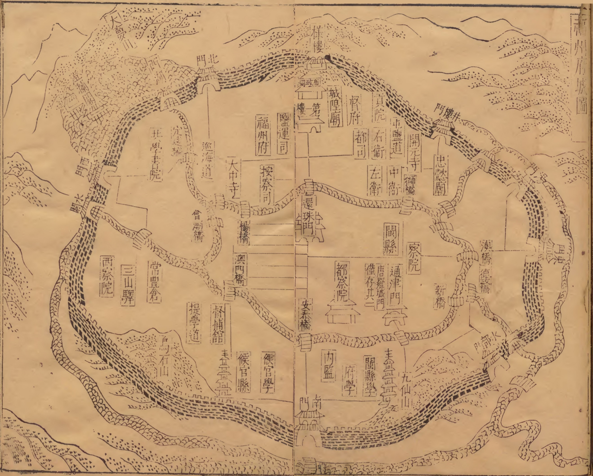
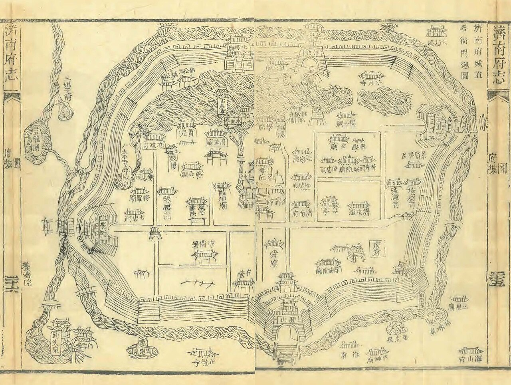
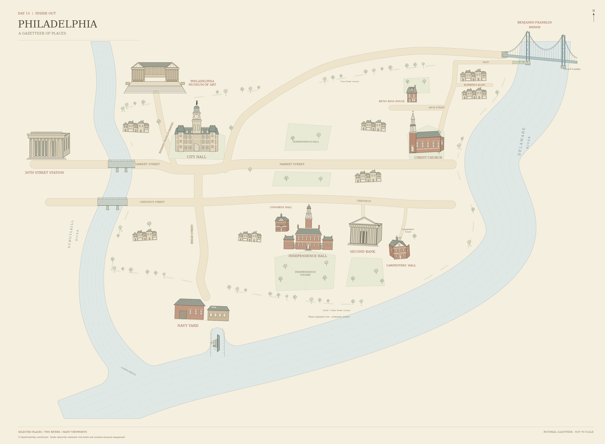

# Day 15 — Inside Out

## Philadelphia: A Gazetteer of Places

### Concept

The theme Inside Out reminded me of traditional Chinese local gazetteer maps (地方志舆图), which represent cities in a very different way from modern maps.

Rather than focusing on precise coordinates, distances, and scales, these maps often emphasize what a city contains: its landmark buildings, characteristic architecture, streets, waterways, and important places. Significant buildings may be enlarged and illustrated from different viewpoints, while ordinary neighborhoods are represented through repeated architectural symbols.

I am particularly interested in how these maps organize urban space. Streets are drawn less as boundaries dividing the city into blocks and more as connections between places. Absolute distances and positions can be simplified or distorted, while relative locations and spatial relationships remain recognizable.

For Day 15, I wanted to use this approach to portray Philadelphia. The Schuylkill and Delaware Rivers establish the city's geographical setting, while selected landmarks, bridges, major streets, and groups of rowhouses reveal its urban character.

Instead of mapping every building and street, I chose to highlight the elements that help us recognize and understand the city. By looking beyond the precise geometry of a modern map, this experiment attempts to turn Philadelphia inside out — revealing the buildings, places, and connections that give the city its identity.

### Visual References

These two traditional Chinese local gazetteer maps illustrate their selective representation of buildings, flexible use of scale, and combination of multiple viewpoints.

*Fucheng tu (府城图), from Fuzhou fuzhi (福州府志), 1613. Named compounds, pictorial buildings, gates, bridges, and waterways share a flexible city layout. Compiled by Yu Zheng and Lin Cai; digitization attributed to the National Archives of Japan. Public-domain work and faithful reproduction, marked PD-Art / Public Domain Mark on [Wikimedia Commons](https://commons.wikimedia.org/wiki/File:%E6%98%8E%E7%A6%8F%E5%B7%9E%E5%BA%9C%E5%9F%8E%E5%9C%96_-_cropped.png). [Archival source](https://www.digital.archives.go.jp/DAS/meta/listPhoto?LANG=default&BID=F1000000000000097152&ID=M2014070419423966017&TYPE=&NO=).*

*Jinan fucheng bing ge yamen zongtu (济南府城并各衙门总图), from Jinan fuzhi (济南府志), 1840. Selected compounds and gate towers appear alongside the city wall, waterways, hills, and connections between places. Public-domain work and digitized reproduction, marked Public Domain Mark on [Wikimedia Commons](https://commons.wikimedia.org/wiki/File:City_of_Jinan_in_1840.jpg); the file record identifies the original gazetteer, date, and compilers.*

These are historical source maps, not modern illustrations made in an antique style. The downloaded previews retain the source images' appearance. Full provenance, download URLs, and rights records are in [references/sources.json](references/sources.json).

### Final Map

[Open the full map](outputs/day15_philadelphia_gazetteer.png).

### Data and Methods

The map uses OpenStreetMap as a geographic reference for major streets, waterways, and landmark locations. Building illustrations are selectively drawn and simplified, with intentionally distorted scales and positions. The result is a pictorial interpretation of Philadelphia rather than a geographically precise map.

### Sources and Credits

Geographic data: [© OpenStreetMap contributors, ODbL](https://www.openstreetmap.org/copyright). Architectural sources and geographic references are recorded in [data/sources.json](data/sources.json). See [METHODS.md](METHODS.md) for reproduction, editable vector assets, river construction, and spatial parameters.

Map by Ming Cao · 30DayMapChallenge 2026
