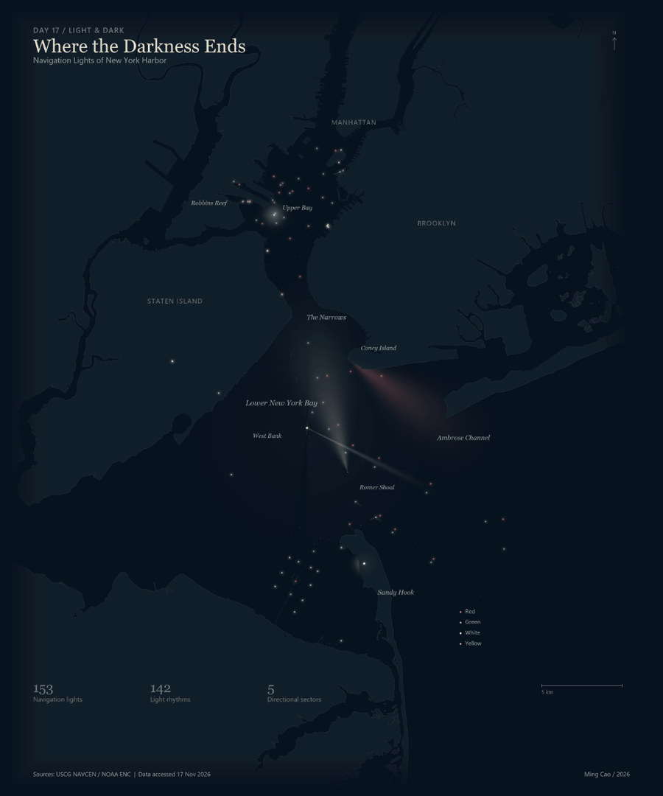

# Day 17 — Where the Darkness Ends

*Navigation Lights of New York Harbor · Light & Dark*

深海军蓝纽约港夜图：扩大、羽化的灯塔光束与数据支持的航标闪烁共同运行。沿用已确认的海岸线、投影、灯塔位置、三层标题、横向统计、图例、Sources 与 Ming Cao 署名。仅在 Day 17 本地制作，未更新 Gallery、未发布、未 commit / push。



## 正式作品

| 文件 | 预览 / 用途 |
|---|---|
| [day17_loop.gif](day17_loop.gif) | 12 秒，900 × 1080，20 fps，128 色固定调色板，无抖动；约 3.4 MB，适合 README 和网页 |
| [day17_loop.mp4](day17_loop.mp4) | 12 秒，1080 × 1296，30 fps，H.264 / yuv420p，faststart；适合社交媒体 |
| [day17.html](day17.html) | 自包含离线交互；双击用 Edge 或 Chrome 打开，无需服务器或联网 |
| [day17.png](day17.png) | 3000 × 3600 高分辨率海报，连续数据模式 0.15 秒快照 |

GIF、MP4、PNG 与 HTML 共用同一套地图图层和渲染代码，不为输出格式重新安排标题、统计或图例。HTML 默认自动播放；系统要求减少动态时初始暂停。后台页面自动暂停。

## 两种时间模式

### Continuous data：准确航标时序的连续 HTML

HTML 默认模式。灯塔光束仍是艺术化 12 秒旋转，但航标的时钟持续运行，不在第 12 秒重置，也不施加接缝渐隐。

- 141 条按已核验原始 SIGSEQ 每段秒数运行。
- 1 条 `Iso Y 6s` 按等明暗定义运行，亮 3 秒 / 暗 3 秒；不冒充原始 SIGSEQ。
- 8 条恒明灯保持常亮。
- 3 条缺少完整可靠时序的登记点维持低亮静态，不猜测周期或脉冲时长。
- 13 条有季节、冰况或靠泊条件的记录默认维持低亮底点；主动开启 **Include conditional-operation scenario** 才播放其节奏，仍不表示当前正在运行。

支持 Play / Pause、Restart、0.5× / 1× / 2×、时间轴、153 条登记搜索与选择、点击航标查看名称、灯色、原始灯质、周期、亮灭序列、条件和来源。实际灯间相位未知；所有共同零相位仅是可视化设定。

### 12 s artistic loop：GIF / MP4 与 HTML 短循环模式

两座旋转光束统一每 12 秒一圈，起始角度不同。12 秒是传播用的艺术参数，**不是历史或现役转速**。

51 条有节奏记录的周期不能整除 12 秒，包括 2.5、5、8 秒等。这些对象的原始 SIGSEQ 和周期没有改写、拉伸或加速：仅在每轮最初 / 最后 **1.2 秒**将参与播放的光晕与亮点平滑衰减至微弱底点，遮掩第 12 秒处的人为显示相位重置。渐隐期间不再属于完整准确的灯光时间复现。条件未启用的对象一直低亮，不另外播放。

周期可整除 12 秒的灯光保留原始节奏；恒明灯与缺时序静态点不受接缝渐隐影响。熄灭时不移除位置底点。短循环与连续数据模式的差别明确显示在 HTML 信息面板中。

GIF 与 MP4 使用同一 30 fps 确定性画面序列；GIF 再按 20 fps 采样、固定 128 色调色板压缩，无整图接缝交叉淡化。MP4 使用 CRF 18 保留暗部层次。两个格式布局相同，只改变分辨率、帧率和编码。

## 灯塔光束：艺术层与数据层分开

| 对象 | 本版表现 | 证据与限制 |
|---|---|---|
| Romer Shoal | 白色光束顺时针 12 秒/圈，980 px 艺术长度 | 历史 20 秒/圈仅作为研究背景，本版不播放该历史转速；当前旋转机制未确认；原登记缺完整 SIGSEQ，登记点保持低亮静态 |
| Coney Island | 红色光束顺时针 12 秒/圈，840 px 艺术长度 | 旧透镜历史 30 秒/圈不再作为本版转速；真实登记点仍按 `Fl R 5s` 的核验序列播放，光束与该灯质是两层不同含义 |
| Sandy Hook | 稳定白光，不旋转 | 核验 F W；辉光尺寸是艺术参数 |
| West Bank | 固定红白方向光，显示长度 720 px | 原角度保留：红 4°–181°、白 181°–4°、白导标 293°–301°；沿用亮 3 秒 / 暗 3 秒，不旋转 |
| Robbins Reef | 绿色周期脉冲，不强制旋转 | 核验亮 0.6 秒 / 暗 5.4 秒；时间边界不人为延长 |

旋转光束相比上一阶段长度增加约 40%，角向高斯宽度也适度增加；继续使用半透明、连续羽化和径向衰减，不画硬三角形。West Bank 不扩大已知角度，只扩大艺术显示长度并保留区内羽化。航标光晕比灯塔光束弱。

灯塔真实位置不动；顺逆时针、初始方向、长度、宽度、亮度及光束形态均为艺术化重构，不是实测。光束长度不取自标称射程。陆海遮罩只调节画面层次，不模拟遮挡、视域、天气、眼高或真实可见范围。

## Methodology / Limitations

- **153**：USCG Light List 独立登记条目数，非物理灯具总数。一个条目可能包含多个灯、passing light、备用灯或颜色扇区，不重复累加。五个主角来自这 153 条，没有新增航标。
- **142**：141 个原始 SIGSEQ 加 1 个 Iso 定义可复现节奏的条目数，不是旋转光束数量。
- **5**：有明确方向扇区角度资料的登记条目数，不是扇区组件总数。
- 本地 CSV 中 7 条 lighthouse 登记实际对应 6 座塔体；共塔关系与现役/历史设备差异见 [灯塔光束研究](lighthouse_beam_research.md)。
- 灯色及有依据的闪烁节奏来自 USCG / NOAA，未拿浮标外观颜色替代灯色，未将所有 Q 灯统一为每分钟 60 闪。
- St. George Ferry Terminal Fog Light（34949）、Romer Shoal（35070）、OPT Lighted Research Test Buoy（35192）缺可靠完整时序，不能按原始数据准确复现闪光；不从 `Fl(2)` 猜测脉冲时长。
- 所有灯光同步展示仅为可视化，不表示港口某一真实时刻；`INACTIVE=0`、有设备或有登记不保证当前正常运行。原 MSI 数据可能过时/不完整的警告保留。
- 原静态图移出的说明在这里完整保留：

> Counts refer to registered entries, not individual fixtures.
>
> Published light characteristics; not a real-time display or navigational chart.
>
> Soft glows are artistic, not calculated light coverage.
>
> Fine directional ticks mark documented sector bearings only.

颜色含义仅是一般解释：Red — starboard-side lateral aids；Green — port-side lateral aids；White — other navigation functions；Yellow — special-purpose aids。没有仅凭灯色给单个对象推定助航功能。

**Not for navigation.**

## 数据与来源

正式清单：[light_inventory.csv](light_inventory.csv)。字段解释：[data_dictionary.md](data_dictionary.md)。来源、版本、SHA-256 与许可记录：[source_manifest.json](source_manifest.json)。历史调查：[data_feasibility.md](data_feasibility.md)、[lighthouse_beam_research.md](lighthouse_beam_research.md)。

USCG NAVCEN Light List District 01 与 NOAA Office of Coast Survey ENC，快照访问日期 2026-11-17。OCS CC0 政策和 ENC 用户协议均有记录；不能将 USCG 数据一并标为 CC0，USCG GeoJSON 专属开放许可证仍未查到。本地作品未公开部署，不使用官方徽章，不暗示背书。Ming Cao / 2026。

`raw/` 保留官方 GeoJSON、32 个 ENC ZIP 及解析用交换文件、出版物、目录和来源页面；它们属于数据与审计证据，不是渲染缓存。`data/` 保留正式海岸线、版式参考、导出参数与检查报告。

## 重新生成

所需环境：Python 3.13（或兼容版本）、Node.js、Microsoft Edge、Segoe UI / Georgia 字体、FFmpeg。Python 与 Node 依赖精确版本见 requirements.txt 和 package.json。

在 `17/` 安装依赖：

```powershell
python -m pip install -r requirements.txt
npm install
```

然后从仓库根目录运行完整构建（或在 Day 17 内运行 scripts/build.py）：

```powershell
& 'C:\ProgramData\anaconda3\python.exe' -B 17/scripts/build.py
```

构建顺序：

1. `scripts/build_scene.py`：同一投影、海岸线、文字与软光束纹理；从 CSV 生成 153 条动画数据。
2. `scripts/build_html.py`：将所有资源内嵌到独立 HTML。
3. `scripts/export_media.py` / `render_frames.cjs`：由同一浏览器画面导出 PNG、GIF、MP4；帧序列和编码调色板只放系统临时目录，完成即删除。
4. `scripts/verify_sources.py`、`verify_final.cjs`、`verify_media.py`：源文件哈希、时序、坐标、标题、交互、循环、解码和输出检查。

可用 `DAY17_BROWSER` 指定其他 Chromium 可执行文件，`FFMPEG_BINARY` 指定 FFmpeg。默认使用本机 Edge；未分发浏览器或 FFmpeg 二进制。日常成图从已保留的正式数据构建，不需要网络或 GDAL。

需要从原始 ENC 重新提取海岸线时，运行 `scripts/prepare_basemap.py`；这一步另需 GDAL。原有数据下载、提取、清单与来源整理流程完整保留在 `scripts/data/`，从仓库根目录运行。不要在无意更新数据快照时执行网络下载。

## 整理与验证

详见 [cleanup_report.md](cleanup_report.md)。旧作品在清理前已归档至系统临时目录，最终目录不保留历史版本、调试截图或渲染缓存。被新版替代的旧 HTML 功能已合并进 day17.html 的连续模式与信息面板。

清理后重新执行完整构建。检查结果为 `data/validation.json`、`data/media_validation.json` 和 `data/media_manifest.json`：153 个点位和核验灯色一致；标题不变；短循环 0/12 秒像素一致；连续模式不做相位重置；GIF 240 帧共 12 秒、MP4 可完整解码，GIF 接缝的变化与片中正常灯光变化相近。
