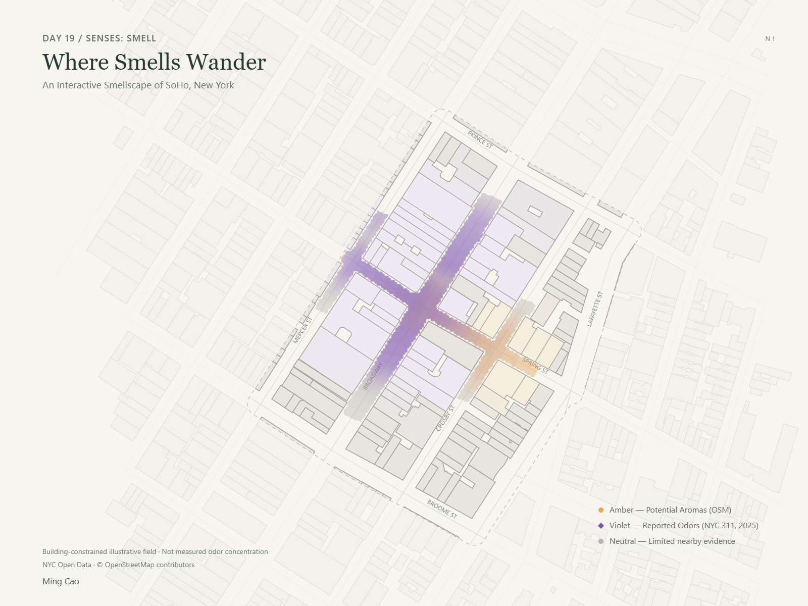

# Day 19 / Senses: Smell

## Where Smells Wander

*A Smellscape of SoHo, New York*

A street-level exploration of six adjoining SoHo blocks between Prince and Broome, from Mercer to Lafayette. One cursor-driven fluid shape reveals how mapped smell evidence relates to the spaces between buildings.



### Outputs and interaction

The GIF is a visual presentation; the HTML provides the fuller interactive experience.

- [Animated GIF](day19_loop.gif): 14-second infinite loop, 1600 x 1200, 210 frames (15 fps average).
- [Poster PNG](day19.png): decoded directly from GIF frame 32 at 2.13 seconds; identical pixels.
- [Interactive HTML](index.html): Explore Smells previews and pins actual records; Explore Space moves one hypothetical field with the cursor.

Run `node 19/server.mjs` from the repository root and open **http://127.0.0.1:8199/**. HTTP is required for local data requests and the module Worker; no API key or online basemap is needed.

### Data and method

The selected area contains **18 OpenStreetMap potential aroma sources** and **12 NYC 311 historical odor/fume complaints from 2025 at 10 distinct coordinates**. Seven indoor complaints were excluded from outdoor modeling. POIs are proxies, not smell observations; complaints are reports, not measured concentrations or evidence against nearby businesses.

NYC Building Footprints and Street Centerline constrain a conservative 2 m obstacle grid. Weighted Dijkstra paths and Marching Squares produce the mouse-driven outline. A separately cached evidence field colors it amber for OSM potential aromas, violet for 311 reports, and neutral where nearby evidence is limited. Duplicate complaint locations are collapsed; each evidence class is normalized separately without summing raw record counts. Pale building tints are cartographic highlights from adjacent open space, not odor entering buildings.

See the [current SoHo study and sources](soho_research.md), [propagation methods and normalization](propagation_methods.md), [data feasibility](data_feasibility.md), [historical site selection](site_selection.md) and [research retention notes](research/README.md). The earlier Williamsburg investigation remains a historical record, not the current map extent.

### Limits

The liquid outline is a building-constrained spatial model. Its colors distinguish evidence categories, not measured odor concentration, pleasantness or health risk. Neither the map nor animation represents real-time smell or validated physical diffusion. Wind, emissions, turbulence and three-dimensional ventilation are not modeled; narrow passages and address-level coordinates introduce uncertainty.

### Reproduce

```powershell
node 19/scripts/rebuild.mjs
node 19/tests/core.test.mjs
python -B 19/scripts/export_media.py
```

The default rebuild uses saved local inputs; use `--refresh` only to intentionally retrieve a new snapshot. Export requires the packages in [requirements-export.txt](requirements-export.txt), Playwright, Edge/Chromium and FFmpeg. It reuses the interactive renderer, writes frames and palettes to an automatically cleaned system temporary directory, and retains only the final media and [export manifest](data/media_manifest.json). No frame archive is required.

### Sources and credits

[OpenStreetMap contributors / ODbL](https://www.openstreetmap.org/copyright) | [NYC 311](https://data.cityofnewyork.us/d/erm2-nwe9) | [NYC Building Footprints](https://data.cityofnewyork.us/d/5zhs-2jue) | [NYC Street Centerline](https://data.cityofnewyork.us/d/inkn-q76z). NYC datasets are subject to [NYC Open Data terms](https://cityofnewyork.github.io/opendatatsm/publicpolicies.html).

Mapping and artwork by **Ming Cao** | [30DayMapChallenge collection](https://mingc404.github.io/30DayMapChallenge/#day-19). Gallery changes are prepared locally; publication requires a separate push.
