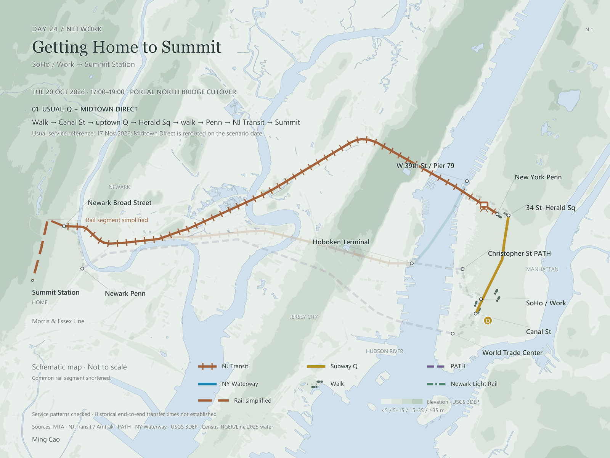

# Day 24 / Network — Getting Home to Summit

By **Ming Cao**.



[Final GIF](summit/outputs/getting_home_to_summit.gif) · [Static overview PNG](summit/outputs/getting_home_to_summit.png) · [Full methods and sources](summit/README.md) · [Gallery copy](GALLERY_BLURB.md) · [Personal collection](../docs/index.html#day-24)

The confirmed animation follows a complete journey from an illustrative SoHo workplace to Summit Station. It compares ordinary Q + Midtown Direct service with alternatives during the **Tuesday, 20 October 2026, 17:00–19:00** Portal North Bridge cutover scenario. The four frames each hold for **3 seconds**, forming an unchanged **12-second infinite loop**, at **1600 × 1200**. No estimated door-to-door commute duration is displayed. Historical complete transfer times were not verified; the regular rail reference and the October service scenario remain separate in the methods.

The basemap uses **USGS 3DEP elevation and Census TIGER/Line 2025 water polygons**, covering all visible land. The brown long-dashed Broad Street–Summit section and the Summit endpoint are schematic. The final GIF/PNG, composition, route patterns, legend and playback timing are unchanged by gallery staging.

## Personal gallery

The main gallery image is the byte-identical GIF at `docs/assets/24/getting_home_to_summit.gif`; the byte-identical PNG at `docs/assets/24/getting_home_to_summit.png` is the static download / fallback. [gallery-entry.json](gallery-entry.json) records the title, author, two English paragraphs and exact supplied alt text.

The personal paragraph is retained verbatim. The only methods-copy correction replaces the supplied OpenStreetMap basemap phrase with **Census TIGER/Line water polygons**, matching the actual final artwork and [source records](summit/README.md). The personal account of occasional journeys over three hours is narrative context, not a verified historical timing estimate.

```powershell
node 24/scripts/update_gallery.cjs
node 24/scripts/check_gallery.cjs
node 19/scripts/preview_gallery.cjs
```

Preview: `http://127.0.0.1:8026/30DayMapChallenge/#day-24`. The scoped updater adds D24 after D23 and preserves other entries and CSS. The browser check reviews desktop/mobile layout, the two paragraphs, paths, PNG/GIF identity and repeated GIF loops. Its reports are retained in `24/review/`; screenshots and temporary frames are not kept. Commit, push and remote deployment are left to the owner.

## Reproduce and retain

See [summit/README.md](summit/README.md) for offline map generation, full-canvas DEM acquisition, route evidence, projection and schematic geometry, and validation commands. The frozen DEM, complete water masks/source ZIPs, schedules/advisories, NJT geometry, route data and generation scripts remain.

The former NYC Ferry topic is archived in [FERRY_RESEARCH.md](FERRY_RESEARCH.md). Its unique GTFS snapshot, source records, network-analysis results and scripts remain in `data/`, `outputs/` and `scripts/`; only its superseded image and reproducible render-only intermediates are removed. It is not shown in the final gallery.
